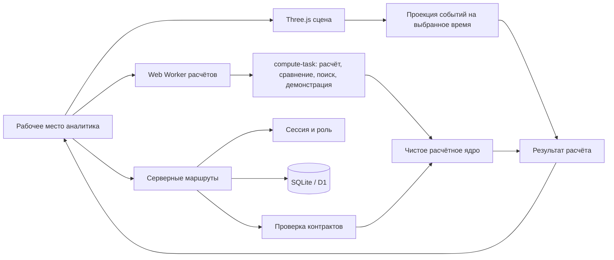
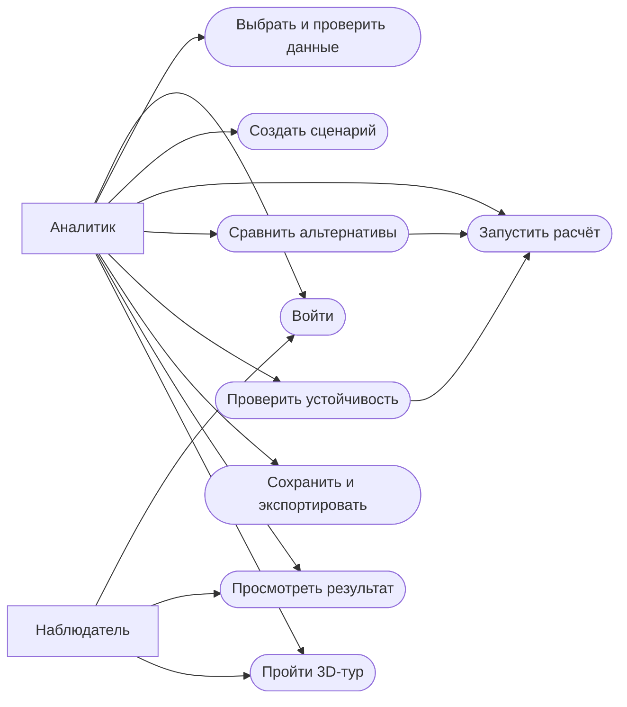
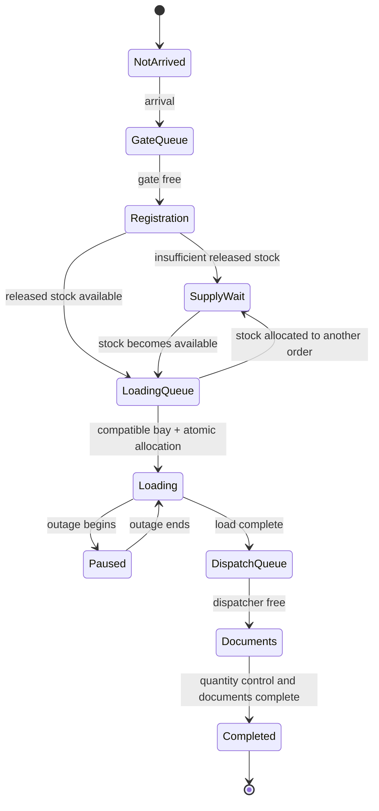
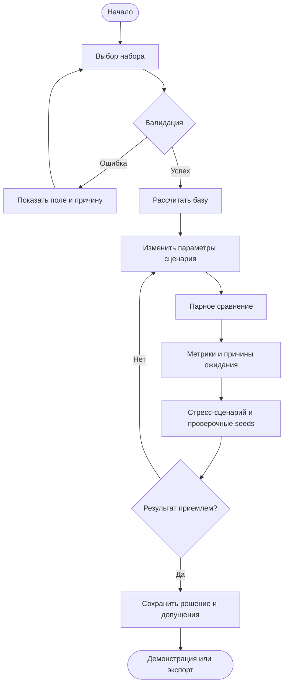
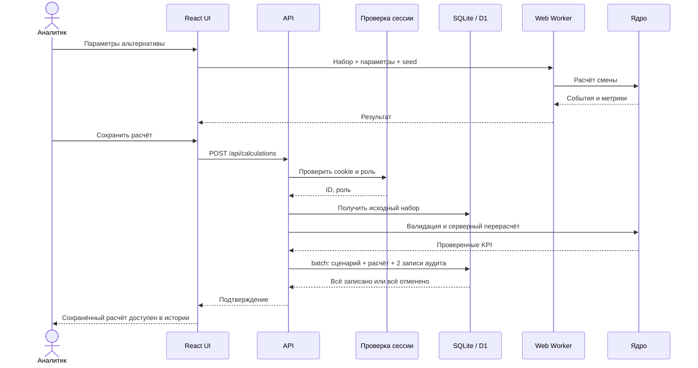
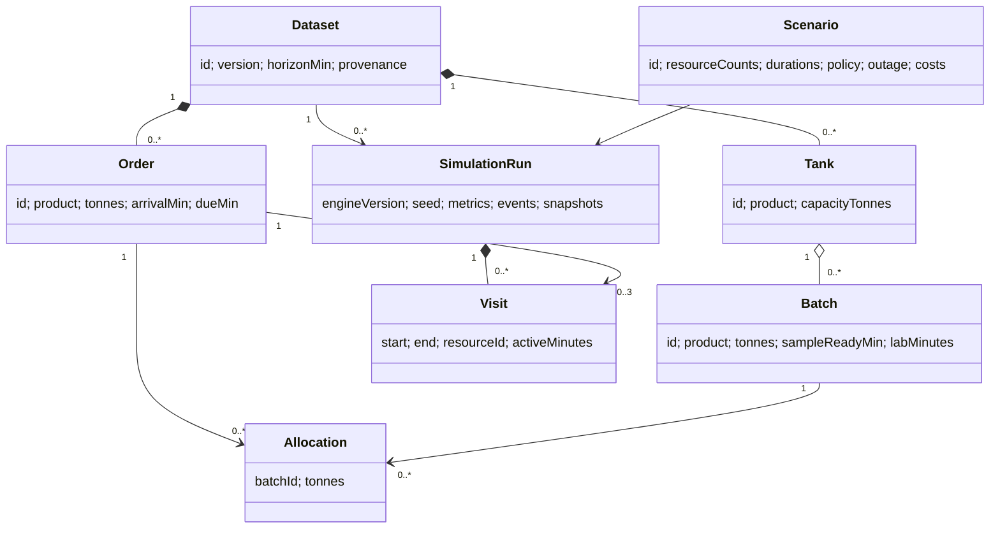
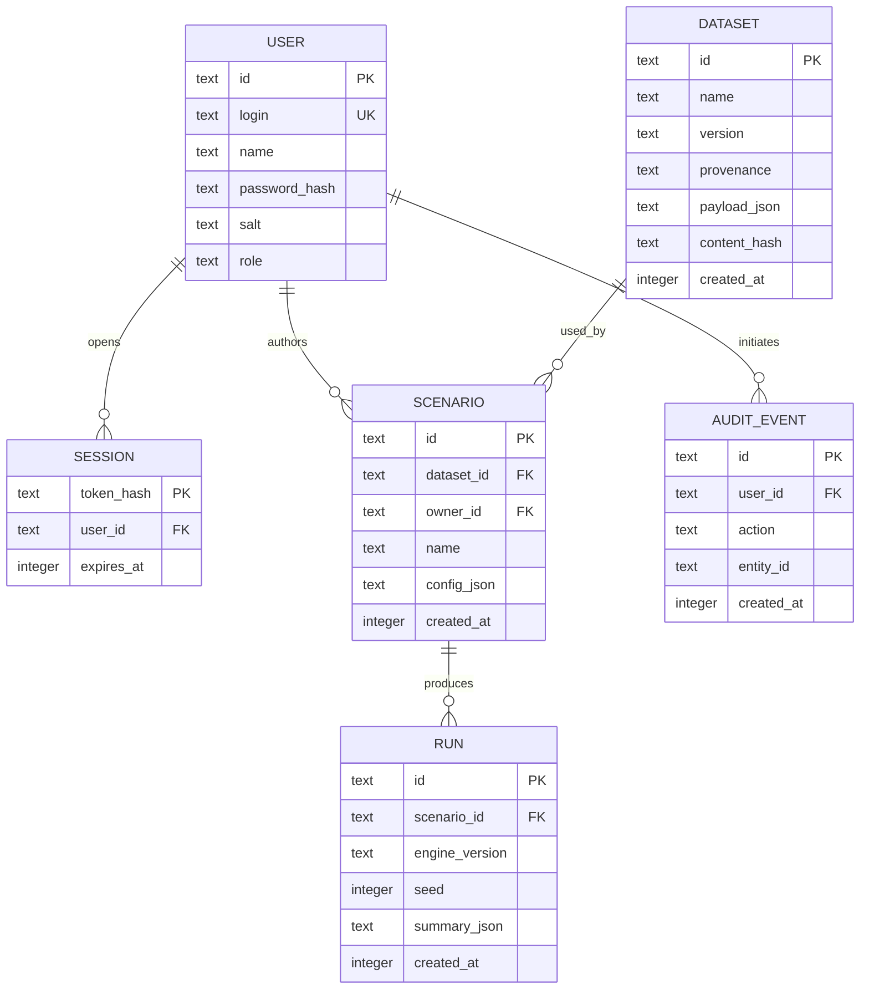

# Архитектура ПОТОК

Статус: ядро, эксперименты, API, постоянное хранение и шесть экранов реализованы. Автоматические проверки и сборка проходят. Слой 3D переработан и проверяется отдельными сквозными сценариями; полная приёмка остальных экранов остаётся отдельным этапом. Подробный статус — в HANDOFF.md и [terminal-3d.md](terminal-3d.md).

## Компоненты

Расчёт не зависит от облака. Browser worker не блокирует интерфейс, получает сериализуемые входы и возвращает прогресс/результат. Сервер валидирует сохраняемые параметры и не доверяет клиентскому названию роли. Сохранённые результаты сопровождаются исходными параметрами и версией; для проверки сервер или CLI может пересчитать их тем же ядром.

## Варианты использования

`compute.worker.ts` отвечает за обмен сообщениями и ошибки; `compute-task.ts` — за состав вычислений. `demonstration.ts` строит четыре воспроизводимых шага на текущем наборе данных. `decision-review.ts` проверяет актуальность сравнения и получает изменения параметров/пик очереди из результатов. Компоненты `scenario-comparison.tsx` и `demonstration-route.tsx` показывают эти данные без повторной реализации формул ядра. `SearchResult.sourceScenario` хранит условия уже выполненного поиска; после их изменения UI помечает предыдущий результат.

Актуальное состояние проверок и ограничения среды: [acceptance.md](acceptance.md).

## Состояния заявки

В ядре пауза представлена интервалом внутри Visit налива; в визуальной проекции она получает отдельное отображаемое состояние. Конец смены не переводит все заявки в Completed, а фиксирует их фактическое состояние.

## Действия аналитика

## Последовательность сохранения и расчёта

## Доменная модель

## Реализованная схема постоянного хранения

Версионированные JSON-поля содержат типизированные доменные объекты. Для демонстрационного масштаба это сохраняет весь вход эксперимента атомарно и не требует множества частичных обновлений. Справочники и связи верхнего уровня нормализованы. При росте объёма детализацию событий следует вынести в отдельное хранилище; полный журнал каждого эксперимента не обязан загружаться в браузер одновременно.

## Контракты

- Данные и параметры валидируются до запуска, ограничения размера применяются до parsing больших тел запросов.
- Входы ядра не мутируются; его результат не зависит от `Date.now`, сети или глобального random.
- Для запуска фиксируются версия ядра, ID/версия и хеш данных, параметры сценария, seeds.
- Локальные предпочтения интерфейса могут храниться в browser storage. Сценарии и расчётные записи хранятся в БД.
- Экспорт не содержит пароль, токен сессии или реальные персональные данные.

## Сохранение и повтор

`POST /api/calculations` сохраняет параметры сценария, один проверенный прогон и аудит одной транзакцией D1 `batch`. Расчёт выполняется до записи. Старые отдельные `POST /scenarios` и `POST /runs` остаются доступны; каждый атомарен со своей записью аудита.

`GET /api/runs/:id` возвращает исходный набор, сценарий и запись расчёта. Сервер проверяет SHA-256 данных. Клиент проверяет версию ядра, повторяет прогон с сохранённым seed и сравнивает все KPI с допуском 1e-9 относительно масштаба числа. При несовпадении выводится ошибка; история не изменяется. Открытие только параметров сценария отдельно обозначено как предварительный расчёт с seed 42.

Миграции локальной БД ведёт Wrangler (`wrangler.local.json`, `scripts/local-db.mjs`). Уже существующая схема принимается только при точном совпадении с начальной миграцией. Скрипт не удаляет данные и не выполняет удалённых запросов к БД.

Основание поведения транзакций и миграций: [D1 Database](https://developers.cloudflare.com/d1/worker-api/d1-database/), [D1 migrations](https://developers.cloudflare.com/d1/reference/migrations/).

## Слой визуального воспроизведения

`SimulationResult → terminal/playback → terminal/renderer → Three.js` — однонаправленная проекция. Визуальный слой не меняет сущности, распределение продукта или результаты. React владеет общим временем, настройками камеры и выбором объекта; Renderer получает их после commit через ref. Динамическая загрузка Three.js, объединение статической геометрии, инстансирование автопарка, отрисовка по изменению и явное освобождение ресурсов уменьшают стоимость сцены. При потере WebGL доступные карточки, события и управление временем остаются рабочими. Подробная карта файлов и данных — в [terminal-3d.md](terminal-3d.md).
