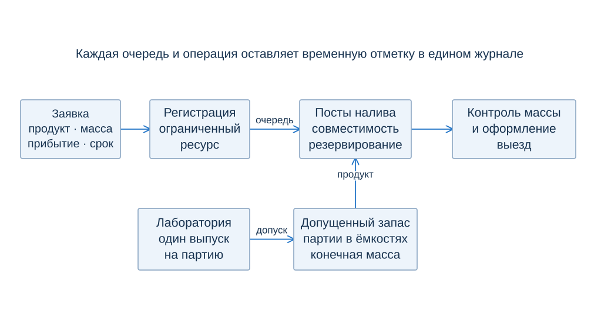
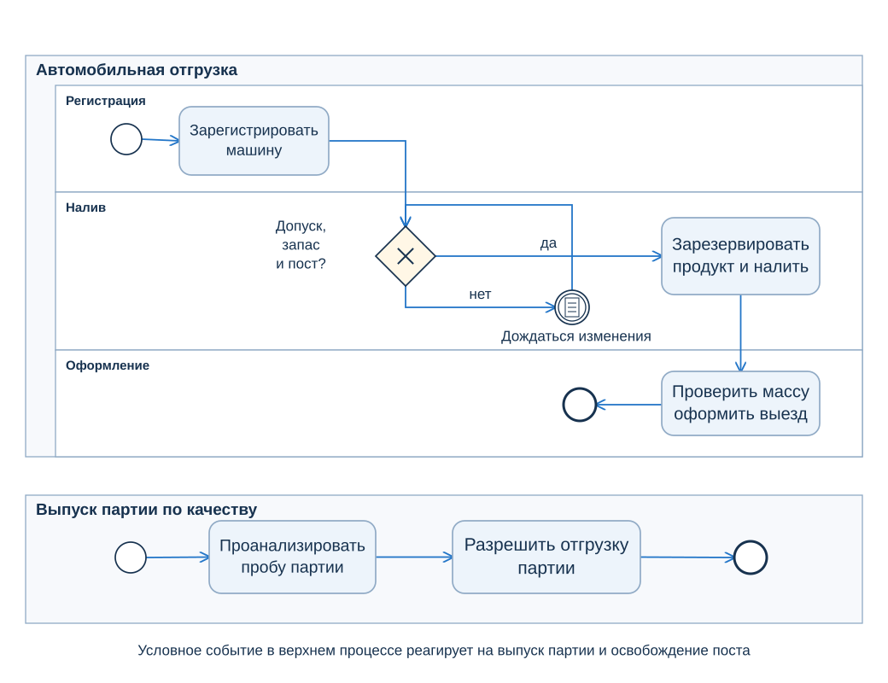
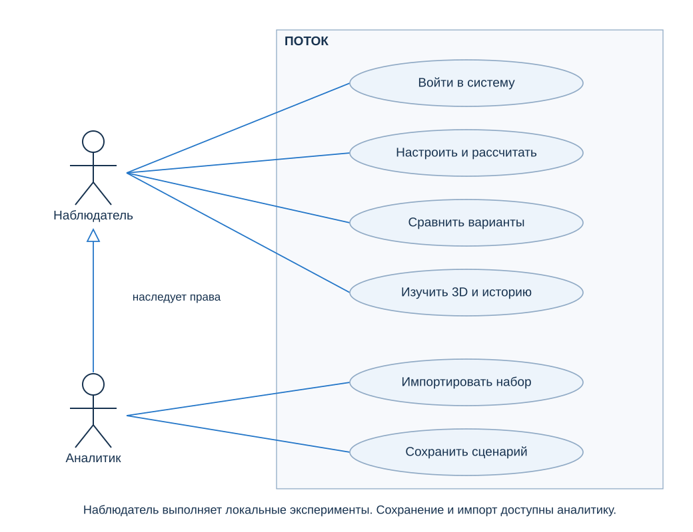
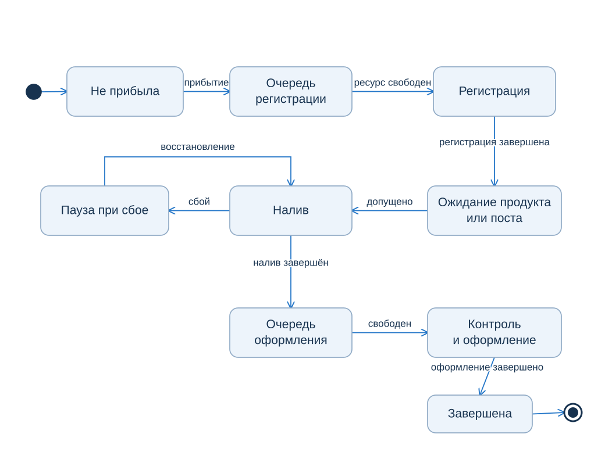
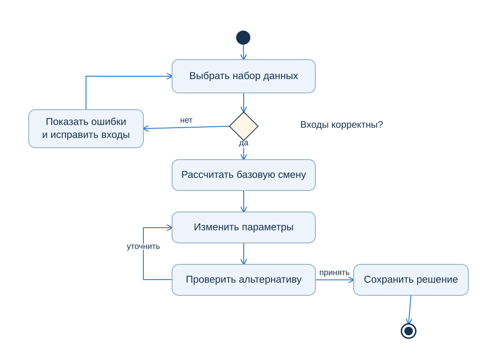
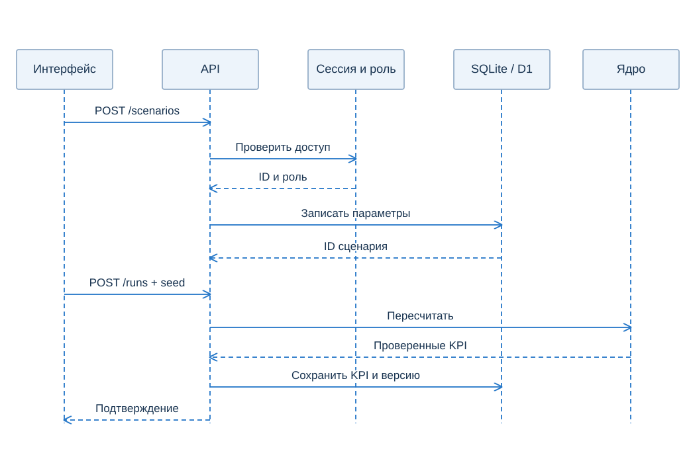
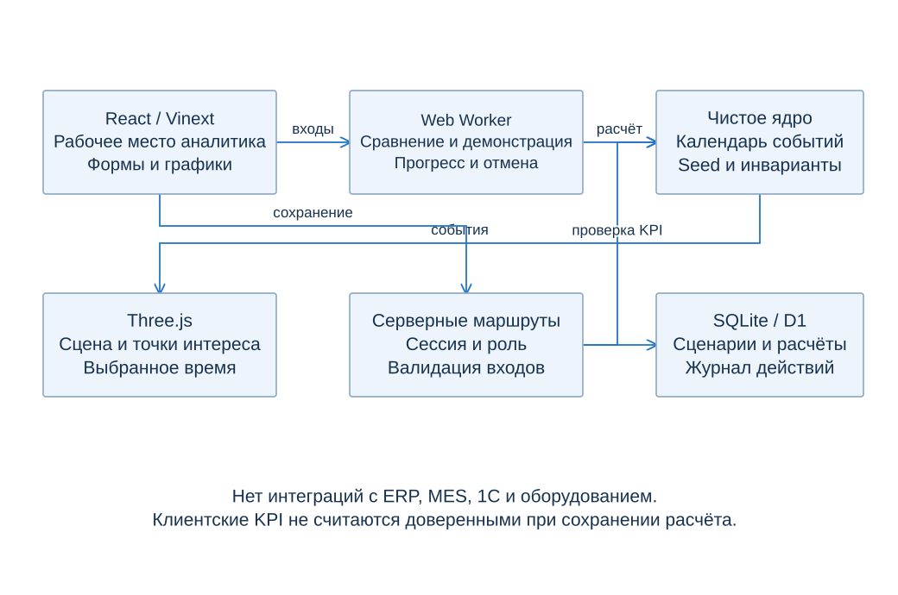
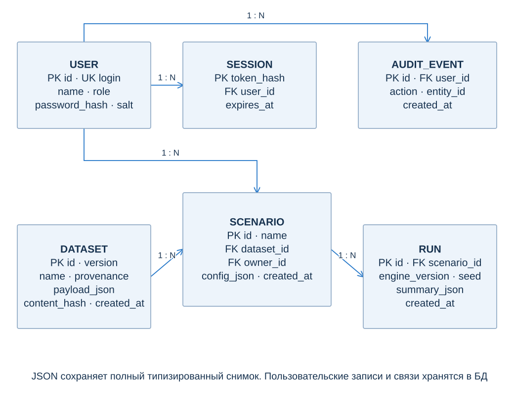
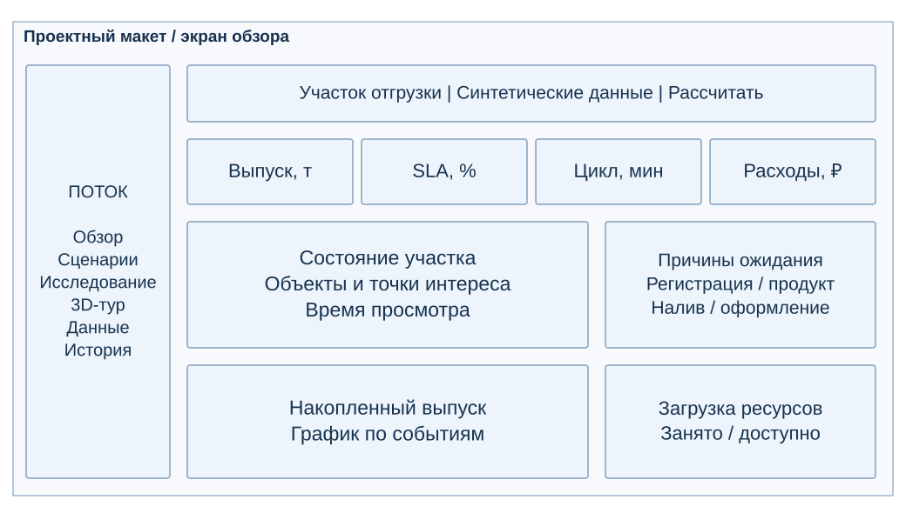
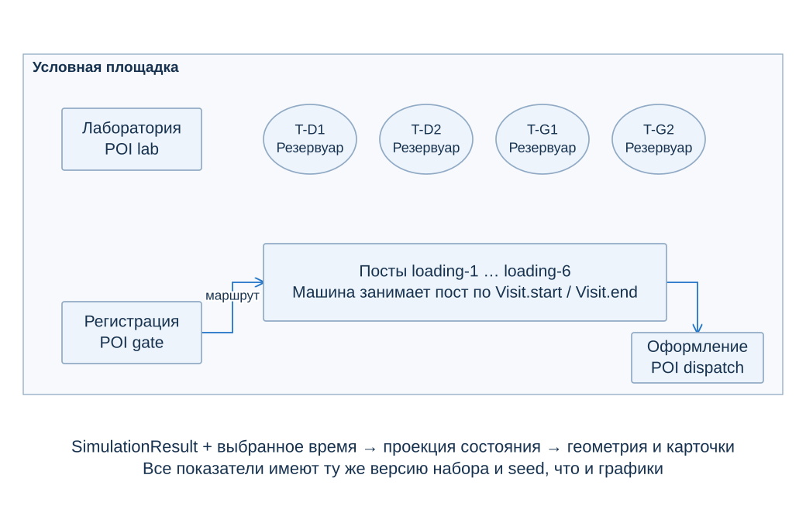

ПОТОК

Техническое заданиеи проектное обоснование

Прототип цифрового двойника автомобильной отгрузки нефтепродуктов

Хакатон УУНиТ 2026Предметный контекст Газпром нефти

Решение помогает аналитику проверить изменение мощности и правил очереди до изменения производственного процесса. Один календарь событий связывает расчёт, графики и браузерную 3D-сцену.

Направление А: цифровой двойник. Визуальное сопровождение: интерактивный тур с точками интереса. Документ задаёт границы модели, требования, архитектуру, проверяемые результаты и порядок приёмки.

| Версия | Состояние |
| --- | --- |
| Документ 1.0 | 9 ноября 2026 года |
| Расчётное ядро 1.0.0 | Дискретно-событийная модель |
| Набор 1.1.0 | 84 заявки, 12 часов, синтетические данные |
| Проверки | 41 автоматическая проверка пройдена; визуальная и сквозная браузерная приёмка предстоит |

Ключевой результат эксперимента

На 30 проверочных прогонах выбранная конфигурация повышает средний SLA с 12,9% до 93,2%. При сбое SLA снижается до 84,4% и не достигает целевых 85%. Этот результат определяет следующий эксперимент, а не скрывается в итоговой оценке.

Все мощности, длительности, расценки и результаты демонстрации условные. Калибровка по данным заказчика и синхронизация с реальным объектом относятся к следующему этапу.

1 Назначение и предметная область

Пользователь решения - аналитик центра производительности труда. Его задача: выяснить, где возникает ожидание, сравнить изменение ресурса и правила обслуживания, объяснить эффект и проверить устойчивость выбранного варианта. Руководитель или участник обучения изучает тот же расчёт в режиме наблюдателя.

Привязка к заказчику

В карточке проекта «Система управления автомобильной отгрузкой нефтепродуктов» указаны заказчик «Газпром нефть» и поставщик «Газпромнефть - Цифровые решения». Описаны слоты, регистрация, назначение постов и оформление транспорта [1]. Годовой отчёт подтверждает автоматизацию терминалов и контроль собственными лабораториями [2].

Поэтому ПОТОК рассматривается как экспериментальная среда для проверки решений и обучения анализу процесса. Наличие у заказчика действующей диспетчеризации учитывается. Потребность именно в предлагаемом экспериментальном модуле пока является гипотезой для проверки на консультации.

Граница моделирования

| Входит | За границей версии 1 |
| --- | --- |
| Одна смена автомобильной отгрузки | Нефтепереработка, гидравлика, движение по дорожной сети |
| Регистрация, налив, оформление | Управление промышленным оборудованием |
| Общий выпуск партии и конечный запас | Пополнение резервуаров в течение смены |
| Очереди, совместимость, один сбой | Ограниченная стоянка, коррелированные аварии |
| Условные операционные расходы | CAPEX, финансовый ROI и тарифы компании |

Учебный сценарий

Участник формулирует гипотезу о причине задержки, проверяет её одиночным расчётом, сравнивает серию смен и защищает решение по метрикам. Точка 3D-тура связывает объект с этапом, показателем и следующим экспериментом. Автоматическое выставление оценки компетенций в текущую версию не входит.

2 Процесс и правила участка

Рисунок 1. Мнемосхема модельного участка

Заявка задаёт продукт, массу, прибытие и крайний срок выезда. После регистрации машина ждёт продукт и свободный совместимый пост. При начале налива вся необходимая масса атомарно резервируется. После налива ограниченный ресурс выполняет контроль количества и оформление.

Лаборатория обслуживает партии. Одно разрешение может открыть запас для многих заявок. Машины не направляются в отдельную лабораторную очередь. Партии, ещё не получившие допуск, остаются в материальном балансе, но недоступны для налива.

| Причина ожидания | Условие |
| --- | --- |
| Регистрация | Прибыла, ресурс регистрации занят |
| Продукт и качество | Зарегистрирована, достаточного допущенного остатка нет |
| Налив | Продукт доступен, свободного совместимого поста нет |
| Оформление | Налив завершён, ресурс оформления занят |

На свободном посту применяется одно из трёх правил: по прибытию, по ближайшему сроку или группировка по продукту. Совместимость повторяется тройками: универсальный пост, дизельный, бензиновый. Это допущение учебного терминала.

3 BPMN процесса отгрузки

Рисунок 2. BPMN 2.0 с отдельным процессом выпуска партии

Верхний процесс создаётся для каждой заявки. Развилка разрешает налив при одновременном наличии допуска, достаточной массы и свободного совместимого поста. В противном случае условное промежуточное событие ожидает изменения состояния.

Нижний процесс создаётся для партии после готовности пробы. Завершение лабораторной операции открывает её запас. Между пулами нет потока управления: общая модель обновляет состояние партии. Схема описывает производственную логику и не предназначена для исполнения как система управления оборудованием.

4 Требования к расчёту

Бизнес-результат считается достигнутым, когда аналитик может повторить расчёт, объяснить причину задержки и сравнить альтернативы на одинаковом спросе. Ни красивый экран, ни рост одного показателя отдельно не подтверждают пригодность решения.

| ID | Функция | Критерий приёмки |
| --- | --- | --- |
| FR-01 | Импорт и валидация | Неверные ID, ссылки, единицы, диапазоны и переполнение резервуара отклоняются |
| FR-02 | Воспроизводимость | Те же входы и seed дают идентичные события и показатели |
| FR-03 | Ресурсы и совместимость | Один пост занят не более чем одной машиной; продукт совместим |
| FR-04 | Допуск и баланс | Налив после допуска; абсолютная невязка массы не более 1e-7 т |
| FR-05 | Сценарии | Изменение параметров, сравнение и сохранение рассчитанного сценария |
| FR-06 | Горизонт | Завершение ровно на границе включается; незавершённые учитываются |
| FR-07 | Узкие места | Очереди по причинам и загрузка рассчитаны из событий |
| FR-08 | Статистика | Парные seeds; интервал среднего эффекта; отдельная проверочная выборка |
| FR-09 | Поиск вариантов | Граница Парето только исследованной сетки; правило выбора явно указано |

FR-01, 02, 03, 05, 06, 07 реализуют модель времени, ресурса и сценариев из слайдов 8 и 10 задания. FR-04, 08 и 09 усиливают проверяемость и объяснимость решения. Полная исходная трассировка находится в docs/requirements.md.

5 Требования к приложению

| ID | Функция | Критерий приёмки |
| --- | --- | --- |
| FR-10 | Сбой ресурса | Пауза меняет календарь и итог, не нарушая баланс |
| FR-11 | Дашборд | Цикл, выпуск, загрузка и расходы с единицами и знаменателями |
| FR-12 | Вход и выход | Неавторизованный запрос отклоняется; выход отзывает сессию |
| FR-13 | Роли | Аналитик сохраняет, наблюдатель читает; права проверяет сервер |
| FR-14 | Хранение | Сценарий и расчёт доступны новой сессии |
| FR-15 | Браузерная 3D-сцена | Навигация Three.js без нативного приложения |
| FR-16 | Точки интереса | Объект связан с этапом, метрикой и аналитическим кейсом |
| FR-17 | Экспорт | Параметры и результат экспортируются для повторения |

Нефункциональные требования

| ID | Требование | Проверяемый ориентир |
| --- | --- | --- |
| NFR-01 | Переносимость | Запуск по инструкции; ядро не требует сети |
| NFR-02 | Адаптивность | Основной путь при ширинах 390, 768, 1440 px |
| NFR-03 | Быстродействие | 84 заявки менее 1 с; поиск 48 x 12 менее 10 с |
| NFR-04 | Доступность | Клавиатура, подписи, состояния различимы без одного цвета |
| NFR-05 | Обработка ошибок | Неверный импорт или отказ сохранения не стирает настройки |

6 Надёжность и границы доступа

| ID | Требование | Реализация и приёмка |
| --- | --- | --- |
| NFR-06 | Базовая защита | HTTP-only сессия, серверные роли, проверка Origin, лимит запроса 1 МБ |
| NFR-07 | Минимизация данных | Условные ID машин и пользователей; ФИО и реальные номера не нужны |
| NFR-08 | Прозрачность модели | Версия, происхождение данных, формулы и допущения доступны |
| NFR-09 | Без внешних интеграций | Нет соединений с ERP, MES, 1С и оборудованием |
| NFR-10 | Отказ WebGL | Точки интереса и метрики доступны в текстовой схеме |

Сессии и роли

Пароль хранится как PBKDF2 SHA-256 с индивидуальной солью и 100 000 итераций. Сессия имеет случайный токен, в базе хранится его хеш. Cookie содержит HttpOnly и SameSite=Strict, Secure включается при HTTPS. Срок сессии - восемь часов. Сервер не принимает роль или готовые KPI на доверии от клиента.

Учётные записи analyst и viewer с паролем Potok-2026! предназначены для публичной демонстрации. Это базовая авторизация прототипа. Перед работой с реальными данными нужны персональные учётные записи, корпоративная политика доступа, ограничение попыток входа, регламент хранения и отдельная проверка защищённости.

Обращение с производственными данными

На первом этапе приложение принимает только синтетические наборы. Проект минимизирует потребность в персональных данных, но не заявляет сертификацию или полное соответствие 152-ФЗ. Решение о составе реальных данных, обезличивании и месте обработки принимается с заказчиком до следующего этапа.

Версии и аудит

Набор хранится как неизменяемый снимок с версией и SHA-256 содержимого. Сохранённый расчёт связан со сценарием, seed и версией ядра. Сервер повторно запускает ядро перед записью показателей. Журнал фиксирует вход, импорт, сохранение сценария и расчёта.

7 Роли и варианты использования

Рисунок 3. UML use case с наследованием прав аналитиком

Наблюдатель изучает процесс, меняет локальные параметры и запускает эксперименты, но не создаёт записи в базе. Аналитик дополнительно импортирует наборы и сохраняет сценарии и расчёты. Оба пользователя видят историю учебного рабочего пространства.

Основной путь: вход, выбор данных, базовый расчёт, изменение гипотезы, серия сравнений, изучение причин ожидания, проверка сбоя, сохранение и экспорт. Изменённые параметры помечаются как ещё не рассчитанные.

8 Состояния заявки

Рисунок 4. UML состояний заявки и паузы при сбое

На схеме ожидание продукта и поста объединено для читаемости. В метриках причины разделены. Условие «допущено» означает одновременно выпуск партии, достаточный остаток, совместимость и доступность поста.

Пауза является интервалом внутри операции налива. После сбоя операция продолжается, продукт не теряется. Это математическое допущение потока, а не инструкция по безопасному останову. Конец смены сохраняет фактическое состояние заявки и не превращает её в завершённую.

9 Действия аналитика

Рисунок 5. UML activity основного аналитического цикла

Ошибки структуры возвращают пользователя к входам. После успешной проверки аналитик рассчитывает базу и формирует альтернативу. Повторение эксперимента меняет явно указанные параметры, сохраняя спрос. Решение сохраняется только после расчёта соответствующей конфигурации.

В исследовании критерий выбора фиксирован: минимальные средние модельные расходы среди вариантов со средним SLA не ниже 85%. Если такого варианта нет, выбирается наибольший SLA, затем меньшая стоимость, с явным сообщением о недостижении порога.

10 Последовательность сохранения

Рисунок 6. UML sequence серверного сохранения

POST /api/scenarios сохраняет проверенную конфигурацию и возвращает ID. POST /api/runs принимает ID сценария и seed, загружает сохранённые входы и запускает ядро на сервере. Клиентские показатели игнорируются. В базе фиксируются серверные метрики, хеш данных и версия ядра.

Каждая операция проверяет действующую сессию и роль. В текущем прототипе запись сценария и последующая запись расчёта - два запроса: при ошибке второго сценарий остаётся в истории. Атомарное сохранение двух сущностей относится к дальнейшему усилению API.

11 Архитектура приложения

Рисунок 7. Компоненты и потоки данных

React и Vinext формируют интерфейс. Чистое TypeScript-ядро работает без сетевых зависимостей. Web Worker выполняет серии прогонов, передаёт прогресс и прекращается при отмене. Серверные маршруты используют то же ядро для проверки сохранённых результатов.

Three.js получает SimulationResult и выбранное время. Проекция определяет состояния машин и ресурсов по фактическим интервалам операций. Анимация не генерирует независимые от модели производственные события. Уровень жидкости в цистерне не моделируется непрерывно.

SQLite используется в локальной эмуляции D1. В схеме шесть таблиц: пользователи, сессии, наборы, сценарии, расчёты, аудит. Миграции хранятся рядом с кодом. Внешнее размещение не требуется для работы CLI-эксперимента.

Контракты входа

До расчёта проверяются конечность чисел, диапазоны, уникальность ID и ссылки между сущностями. До разбора JSON сервер ограничивает тело запроса. Максимум: 2 000 заявок, 300 партий, 100 резервуаров, шесть постов налива, горизонт 10 080 минут. Большие наборы требуют отдельного замера производительности.

12 ER модель и словарь хранения

Рисунок 8. ER модели с кардинальностью один ко многим

Первичные ключи - текстовые ID. Один пользователь имеет несколько сессий, сценариев и событий аудита. Один набор используется несколькими сценариями, один сценарий имеет несколько расчётов. Все обязательные внешние ключи заданы в схеме Drizzle.

В RUN поле seed имеет целочисленный тип и относится к одному сохранённому прогону. Серия статистического сравнения хранится в экспортном JSON, а не притворяется одной записью одиночного расчёта. Время создания и истечения хранится в миллисекундах Unix.

13 Сущности и атрибуты

| Таблица | Атрибуты и типы | Назначение |
| --- | --- | --- |
| users | id TEXT PK; login TEXT UNIQUE; name TEXT; password_hash TEXT; salt TEXT; role TEXT | Пользователь и серверная роль |
| sessions | token_hash TEXT PK; user_id TEXT FK; expires_at INTEGER | Отзываемая серверная сессия |
| datasets | id TEXT PK; name, version, provenance, payload_json, content_hash TEXT; created_at INTEGER | Полный неизменяемый входной набор |
| scenarios | id TEXT PK; dataset_id, owner_id TEXT FK; name, config_json TEXT; created_at INTEGER | Параметры альтернативы и автор |
| runs | id TEXT PK; scenario_id TEXT FK; engine_version TEXT; seed INTEGER; summary_json TEXT; created_at INTEGER | Проверенные метрики одиночного прогона |
| audit_events | id TEXT PK; user_id TEXT FK; action, entity_id TEXT; created_at INTEGER | История действий |

Доменные объекты в JSON

| Сущность | Основные поля |
| --- | --- |
| Dataset | id, version, provenance, horizonMin, orders[], tanks[], batches[] |
| Order | id, product, tonnes, arrivalMin, dueMin |
| Tank | id, product, capacityTonnes |
| Batch | id, tankId, product, tonnes, sampleReadyMin, labMinutes |
| Scenario | Число ресурсов, длительности, policy, dedicatedBays, outage, costs |
| Visit | start, end, resourceId, activeMinutes |
| Allocation | batchId, tonnes |

Dataset содержит заявки, резервуары и партии. Каждая Batch ссылается на Tank. Заявка имеет до трёх Visit и несколько Allocation. Allocation связывает заявку с одной или несколькими партиями того же продукта. Сумма выделений при старте налива равна массе заявки.

14 Расчётная модель и метрики

Календарь событий - устойчивая min-heap по времени и порядку вставки. На одной отметке сначала обрабатываются уже запланированные события, затем распределяются свободные ресурсы. Нулевые операции проходят следующий конечный цикл на той же отметке. Завершение точно на границе горизонта включается в выпуск.

| Показатель | Определение |
| --- | --- |
| Выпуск, т | Сумма масс заявок, завершивших оформление не позднее H |
| Производительность, т/ч | Выпуск / (H / 60) |
| SLA | Число завершённых до срока и H / все заявки исходного спроса |
| Средний цикл, P95 | Время от прибытия до завершения, только по завершённым заявкам |
| Среднее ожидание, мин | Очереди всех прибывших / число прибывших, включая незавершённых |
| Загрузка ресурса | Продуктивные минуты / доступные минуты внутри горизонта |
| Модельные расходы, руб. | Ресурсы за смену + машино-часы очереди x ставка + тоннаж законченного налива x ставка |

Материальный баланс

Начальный запас = нераспределённый остаток + масса незавершённого налива + загружено без выезда + отгружено. Допуск партии не создаёт новую массу. Величина «зарезервировано» описывает учётную массу операции, а не непрерывное физическое движение жидкости.

Что предотвращает ложное улучшение

Незавершённые машины не исчезают из очередей и SLA. При отсутствии завершений цикл и стоимость на отгруженную тонну равны null. Недоступность вычитается из знаменателя загрузки. Стоимость ожидания учитывает очередь, но не паузу уже начатого налива. Более короткий цикл завершённых сам по себе не означает лучший результат.

15 Случайность и дизайн эксперимента

Длительность регистрации, оформления и лаборатории равна базовой длительности, умноженной на фактор. Налив включает подготовку, переключение продукта при необходимости и 60 x масса / скорость. Фактор задаётся формулой 1 + v x (U1 + U2 - 1), где v=0,25 в демонстрации.

U1 и U2 вычисляются из стабильного ключа seed, ID сущности и операции. При изменении порядка очереди одна заявка получает тот же внешний множитель длительности. Между альтернативами фиксируются спрос, массы, прибытия и сроки. Это парное сравнение, а не две несвязанные случайные смены.

| Этап | Условия |
| --- | --- |
| Набор данных | Версия 1.1.0; 84 заявки; 1 974 т спроса; 720 минут; четыре партии и четыре резервуара |
| Начальный запас | 3 100 т: дизель 1 800 т и бензин 1 300 т |
| Сроки | Три класса: 90, 150, 240 минут после прибытия с ограничением горизонтом |
| Поиск | 48 конфигураций: 3-6 постов, 1-2 оформления, 1-2 лаборатории, три правила; 12 seeds |
| Проверка | 30 других seeds; сравнение с исходной конфигурацией |
| Стресс | Первый пост недоступен с 240-й по 360-ю минуту; одинаковый сбой у базы и кандидата |
| Чувствительность | 150, 300, 600 и 900 руб. за машино-час очереди |

95% доверительный интервал среднего эффекта вычисляется по парным разностям с t-критическим значением. P10-P90 описывает разброс результатов отдельных модельных смен. Эти величины не взаимозаменяемы. Интервалы отражают заданную случайность длительностей при фиксированном спросе, а не точность реального прогноза.

16 Результат независимой проверки

База использует три поста, один ресурс оформления, одну лабораторию и FIFO. В исследованной сетке при пороге среднего SLA 85% выбран вариант: шесть активных постов, два ресурса оформления, одна лаборатория, очередь по ближайшему сроку. Открытие постов трактуется как использование имеющейся условной мощности.

| Показатель | База | Кандидат | 95% CI разности |
| --- | --- | --- | --- |
| Отгружено, т | 1 105,4 | 1 974,0 | 859,4 ... 877,7 |
| Завершено, заявок | 46,3 | 84,0 | 37,3 ... 38,1 |
| SLA, % | 12,9 | 93,2 | 78,9 ... 81,8 |
| Очередь, мин на заявку | 246,9 | 57,4 | -190,3 ... -188,5 |
| Незавершено, заявок | 37,7 | 0,0 | -38,1 ... -37,3 |
| Модельные расходы, тыс. руб. | 431,5 | 285,5 | -147,3 ... -144,8 |

Средние по 30 проверочным прогонам. Разность = кандидат минус база; для SLA она указана в процентных пунктах. Полный набор исходных метрик, seeds и параметров сохранён в reference-experiment.json.

Причина результата

В одиночной базовой смене с seed 42 ожидание постов налива составляет 330,9 машино-часа. Ограничение мощности создаёт основную очередь. Изменение ресурсов и приоритетов уменьшает её, а дополнительные ресурсы повышают фиксированную часть расходов. Итоговая разность определяется обоими эффектами.

Условная экономика

Ставки: регистрация 550 руб./ч, лаборатория 1 100 руб./ч, пост 1 700 руб./ч, оформление 650 руб./ч, очередь 900 руб./машино-час, обработка 28 руб./т. Снижение модельных расходов не является фактической экономией Газпром нефти. CAPEX и прибыль от дополнительного выпуска не рассчитаны.

17 Устойчивость и чувствительность

При двухчасовой недоступности первого поста выбранный вариант сохраняет средний выпуск 1 974 т, но средний SLA падает до 84,4%. 95% CI среднего SLA: 82,4 ... 86,4%. P10-P90 отдельных смен: 75,0% ... 89,4%.

Решение по стрессу

Порог 85% в данном стресс-сценарии не выполнен в среднем. Следовательно, конфигурация пригодна как кандидат для обычных условий модели, но пока не подтверждает целевой уровень при заданном сбое. Следующий шаг - согласовать обязательный уровень устойчивости и проверить меры по расписанию прибытия, резерву мощности или длительностям операций.

| Очередь, руб./маш.-ч | Расходы кандидата, тыс. руб. | Вариантов Парето |
| --- | --- | --- |
| 150 | 225,7 | 11 |
| 300 | 238,3 | 10 |
| 600 | 263,4 | 3 |
| 900 | 288,6 | 4 |

Чувствительность рассчитана на тех же 12 поисковых seeds. Во всех четырёх точках при пороге SLA 85% выбран тот же вариант. Однако состав границы Парето меняется: цена ожидания влияет на компромисс. Перерасчёт стоимости не меняет физические события, поскольку расценки не участвуют в диспетчеризации.

Ограничение доказательства

Граница Парето относится только к 48 рассмотренным конфигурациям. Поиск не доказывает глобальную оптимальность. Проверочный набор отделён от поискового, но результат всё ещё зависит от синтетического спроса и допущений. Использовать эти числа для решения о реальном объекте без калибровки нельзя.

18 Интерфейс и навигация

| Экран | Состав и действие |
| --- | --- |
| Обзор смены | Выбранный сценарий; KPI выпуска, SLA, цикла и расходов; причины ожидания; выпуск во времени; загрузка; состояние процесса |
| Сценарии | Число ресурсов, длительности, совместимость, политика очереди, seed, сбой и ставки; сравнение 30 смен; сохранение |
| Исследование | 48 конфигураций; Парето; отдельная проверка; стресс; чувствительность к цене ожидания; таблица вариантов |
| 3D-тур | Условная площадка, время просмотра, вращение камеры, точки интереса, список транспорта |
| Данные и модель | Версия и происхождение; импорт/экспорт JSON; баланс; формулы и границы |
| История | Сохранённые сценарии, серверные расчёты и повторное открытие |

Проектный макет дашборда

Рисунок 9. Проектное размещение элементов интерфейса

Это описание проектного макета, а не скриншот пройденной браузерной приёмки. Реализация находится в components/potok-app.tsx и globals.css. Требуется проверить основной путь на 390, 768 и 1440 px, читаемость графиков, диалоги, ошибки сохранения и управление клавиатурой.

19 3D сцена и точки интереса

Рисунок 10. Проектная карта сцены и связи с расчётом

| Точка | Показатель | Аналитический кейс |
| --- | --- | --- |
| Регистрация | Загрузка и очередь gate | Поможет ли дополнительный регистратор при текущем ограничении? |
| Лаборатория | Загрузка lab и допуск партий | Влияет ли ускорение выпуска на ожидание продукта? |
| Резервуар | Остаток по ID партии и tankId | Есть ли достаточный допущенный запас нужного продукта? |
| Пост налива | Загрузка конкретного loading-N | Как совместимость и сбой меняют доступную мощность? |
| Оформление | Загрузка и очередь dispatch | Переместилось ли ограничение после открытия постов? |

Планировка условная и не воспроизводит конкретный объект компании. Геометрия ограничена шестью постами, четырьмя резервуарами и 120 отображаемыми машинами. Больший набор полностью учитывается ядром, но требует расширения сцены. KPI карточек относятся к целой смене, положение машин - к выбранному времени.

20 План тестирования и приёмка

| Группа | Проверка | Состояние |
| --- | --- | --- |
| Ядро | Аналитическая смена из одной и двух заявок; точные время и очереди | Пройдено |
| Инварианты | Масса, неотрицательный запас, совместимость, последовательность событий, отсутствие двойной занятости | Пройдено |
| Границы | Нулевые ресурсы, пустой спрос, горизонт внутри операции и ровно в завершении | Пройдено |
| Сбой | Активная и ещё не начатая операция, пересечение горизонта | Пройдено |
| Эксперименты | Парные разности, CI, Парето, дубли seeds, чувствительность стоимости | Пройдено |
| API на SQLite | Роли, cookie, выход, срок сессии, новая сессия, поддельные KPI, ошибки и размер JSON | Пройдено |
| Проекция времени | Границы Visit, будущие завершения не видны, пауза | Пройдено |
| Браузерный путь | Вход, импорт, запуск worker, навигация, сохранение, повторное открытие | Предстоит |
| Адаптивность и WebGL | 390 / 768 / 1440 px, отказ WebGL, клавиатура и читаемость | Предстоит |

Всего 41 автоматическая проверка. TypeScript и production-сборка проверяются отдельными командами. Они подтверждают техническую целостность, но не заменяют сквозной браузерный тест. Сохраняется отдельный протокол ручной приёмки.

Эталонный CLI-эксперимент из поиска и проверок на текущей машине занял 0,634 с. Это один замер в Node.js при 84 заявках, а не гарантия для любого устройства, браузера или предельного объёма данных.

21 Внедрение и следующий этап

Комплект результата

Исходники приложения и ядра, схема БД и миграции, синтетический набор JSON, полный эксперимент JSON, техническое задание, редактируемые схемы draw.io, сценарий демонстрации и материалы защиты. Команды проверки и запуска фиксируются в README проекта.

Порядок пилота с заказчиком

| Шаг | Результат и условие перехода |
| --- | --- |
| 1 Подтвердить процесс | Согласованные этапы, типы ресурсов, ограничения постов и правило выпуска партии |
| 2 Подготовить данные | Обезличенные заявки, временные отметки операций, остатки, допуски и простои |
| 3 Оценить параметры | Распределения длительностей и расценки из истории; отдельно данные для проверки |
| 4 Проверить воспроизведение | Сравнить выпуск, очереди и незавершённые с наблюдением; согласовать допустимую ошибку |
| 5 Согласовать эксперимент | Реальные ограничения изменений, целевой SLA и допустимые стресс-условия |
| 6 Принять решение | Экспертная проверка результата; протокол ограничений и плана контролируемого пилота |

Что нужно получить на консультации

Как выпускается партия? Какие продукты совместимы с постами? Какие поля событий доступны? Есть ли ограничения стоянки и расписание слотов? Что считается выполнением к сроку? Какие статьи затрат можно сравнивать? Какой уровень обслуживания требуется при отказе ресурса? Какие ошибки прогноза приемлемы?

До этих ответов ПОТОК остаётся проверяемым учебным прототипом. Для этапа II основная работа - калибровка и проверка на реальных данных, а также закрытие интерфейсной приёмки и требований к размещению.

22 Источники и воспроизводимость

Основание задания: 12 слайдов «Презентация 2х хакатон (1).pptx», предоставленных участником. Слайды 6-7 задают проектные артефакты, 8-10 функциональность двойника и тура, 11 структуру ТЗ, 12 технические ограничения. Сообщение организатора допускает синтетические данные на первом этапе.

[1] Система управления автомобильной отгрузкой нефтепродуктов. Карточка проекта, 27.10.2022https://globalcio.ru/projects/27877/

[2] Годовой отчёт ПАО Газпром нефть за 2024 год. Печатные страницы 61-62. Копия корпоративного документаhttps://investonic.ru/wp-content/uploads/2025/07/godovoj-otchet-gazpromneft-sibn-2024.pdf

[3] GROTEM. Единая система отгрузки нефтепродуктов для Газпромнефть Логистикиhttps://grotem.com/projects/gazpromneft-logistika-eson

[4] INLINE GROUP. Информационная система исполнительного баланса цепочки поставок нефтепродуктовhttps://inlinegroup-c.ru/projects/informacionnaya-sistema-formirovaniya-ispolnitelnogo-balansa-cepochki-postavok-nefteproduktov1/

Воспроизводимый эксперимент

Команда в каталоге app: node --experimental-strip-types scripts/run-experiment.ts. Проверки: node --experimental-strip-types --test tests/*.test.ts. Проверка типов: node node_modules/typescript/bin/tsc --noEmit. Для Node требуется версия 24, поскольку интеграционные тесты используют node:sqlite.

Поиск: makeSeeds(20261109, 12). Проверка: makeSeeds(987654321, 30). Значение i-го seed вычисляется как (start + imul(i, 104729)) по модулю 2^32. Начальный спрос генерируется отдельно и сохраняется в synthetic-dataset.json. Его версия - 1.1.0.

Исходные файлы доказательств: app/outputs/experiments/reference-experiment.json; docs/model-specification.md; docs/requirements.md; docs/research.md; app/tests. Схемы в docs/diagrams доступны как SVG, PNG и редактируемый draw.io. Изменение входных данных требует повторной генерации отчёта.
